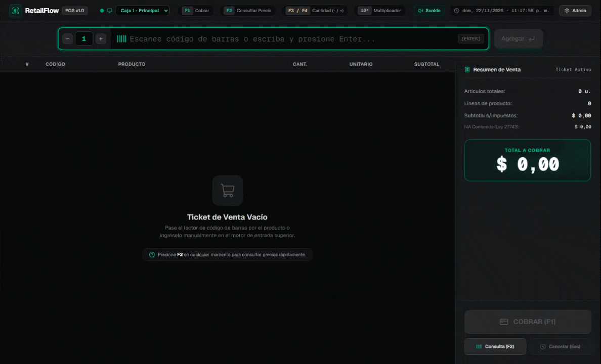
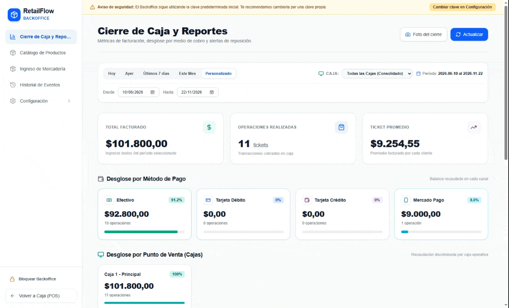
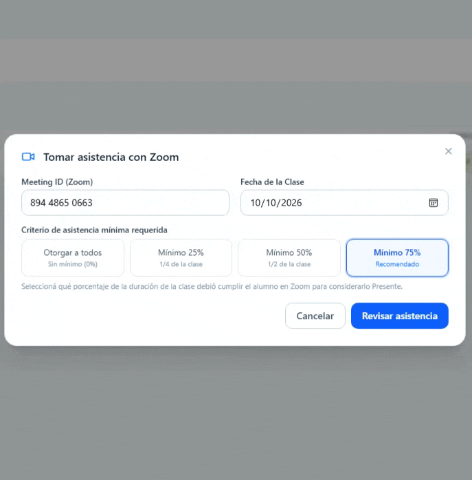

# Hola, soy Diego Otranto 👋

**Desarrollador Full Stack Jr · Inglés C2 (EFSET)** — Buenos Aires, Argentina

Soy desarrollador full stack formado en la UTN (cursada completa de la Tecnicatura Superior en Programación).
Construyo aplicaciones web de punta a punta: APIs REST con NestJS, TypeORM y PostgreSQL, y frontends con React,
Next.js y Angular, además de contar con base en Java y Spring Boot. Actualmente desarrollo la toma de asistencia
integrada con Zoom para la Libreta Universitaria Digital de la UTN (PPS). Escribo tests unitarios con Jest y
combino desarrollo asistido por IA (Antigravity) con buenas prácticas para iterar rápido sin descuidar la calidad.

---

## Proyectos destacados

### [RetailFlow POS](https://github.com/Diego-otr/retailflow-pos)
Sistema de punto de venta (POS), gestión de inventario y backoffice pensado para supermercados de barrio y comercios
minoristas. La caja funciona 100% guiada por teclado y lector de código de barras (alta rápida de productos en caja,
múltiples medios de pago con recargos/descuentos, desglose de IVA contenido Ley 27.743 y soporte multi-caja), y el
backoffice incluye cierre de caja exportable, reportes y control físico de stock en góndola adaptado a mobile. Cuenta
con 243 tests unitarios (129 en backend y 114 en frontend) y despliegue local con Docker.
`TypeScript` `Next.js` `NestJS` `TypeORM` `PostgreSQL` `Tailwind CSS` `Jest` `Docker`

### Libreta Universitaria Digital — UTN *(PPS en curso · repo privado)*
Plataforma de gestión académica de la UTN pensada para uso real de los estudiantes: consulta de historial de notas,
inscripciones y estado de materias, desarrollada en equipo como Práctica Profesional Supervisada. Soy responsable de
la funcionalidad de toma de asistencia automatizada mediante integración con Zoom, con criterios configurables de
permanencia mínima y revisión previa antes de confirmar presentes.
`Next.js` `NestJS` `TypeORM` `PostgreSQL` `Zoom API` `Docker`

### [Sistema de Gestión de Turnos de Salud](https://github.com/Santinoco/AppMedicos)
Plataforma web desarrollada en equipo en la UTN para centralizar la asignación de turnos médicos, el seguimiento de
pacientes y la carga de mediciones clínicas. Responsable principal del frontend de la aplicación.
`React` `Next.js` `NestJS` `PostgreSQL`

### [E-commerce (Simulación laboral Alkemy)](https://github.com/alkemyTech/OT285-client)
Aplicación web de comercio electrónico desarrollada en un equipo de 4 personas bajo metodología Scrum, con tareas
gestionadas en Jira y control de versiones en Git. Foco principal en el frontend en Angular y su integración con los
endpoints del backend en Java y Spring Boot.
`Angular` `TypeScript` `Java` `Spring Boot` `Jira` `Scrum`

---

## Con qué trabajo

**Frontend:** TypeScript, JavaScript, React, Next.js, Angular, Tailwind CSS, HTML, CSS

**Backend:** Node.js, NestJS, Express, Java, Spring Boot, APIs REST

**Bases de datos y testing:** PostgreSQL, MySQL, TypeORM, Jest (tests unitarios), Postman

**Herramientas e IA:** Git, GitHub, Docker, Jira, Scrum, desarrollo asistido por IA (Antigravity)

---

<b>In English</b>

I'm a Junior Full Stack Developer based in Buenos Aires, Argentina, trained at UTN (Technical Degree in Programming —
coursework completed, currently working on my final supervised practicum). I build end-to-end web applications with
NestJS, TypeORM, and PostgreSQL on the backend, and React, Next.js, and Angular on the frontend, with a solid
foundation in Java and Spring Boot. I write unit tests with Jest, use AI-assisted development (Antigravity), and hold
a C2 Proficient English certification (EFSET).

Highlights: [RetailFlow POS](https://github.com/Diego-otr/retailflow-pos) (full-stack POS & backoffice for
neighborhood supermarkets, 243 unit tests) · **UTN Digital Academic Record** (automated attendance tracking via Zoom
integration, private repo) · [Medical Appointments Platform](https://github.com/Santinoco/AppMedicos) (frontend lead,
React/Next.js) · [Alkemy E-commerce](https://github.com/alkemyTech/OT285-client) (Angular + Java/Spring Boot, Scrum
team).

